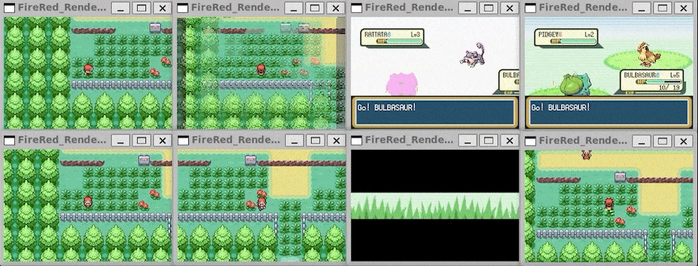
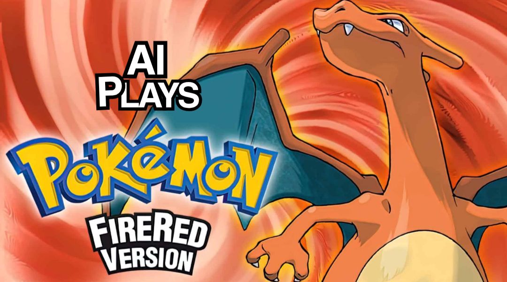
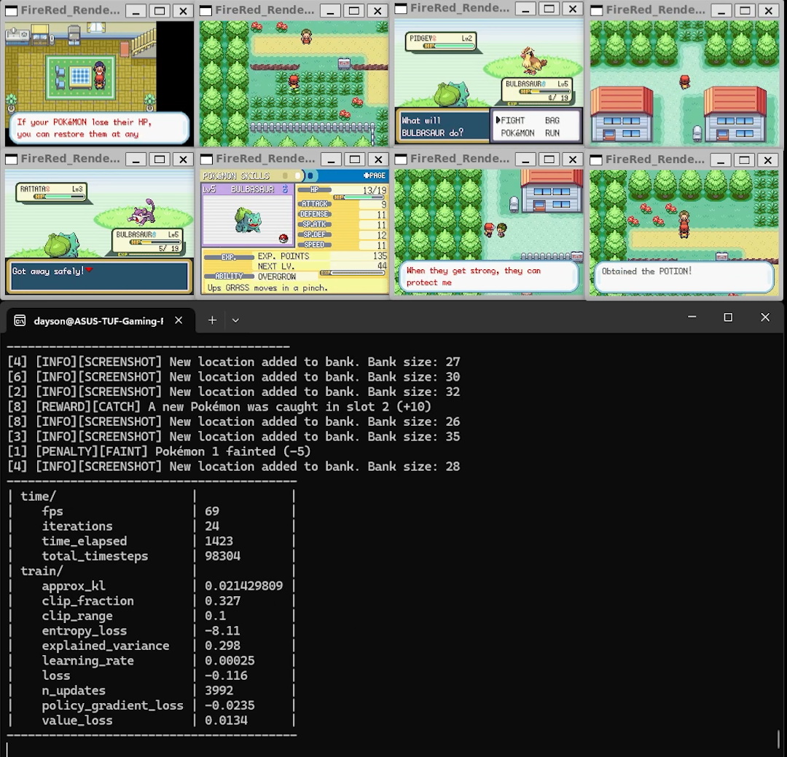

# Pokémon FireRed AI Agent 🎮🤖

An advanced Reinforcement Learning framework and research testbed for **Pokémon FireRed (Game Boy Advance)** using **Stable-Baselines3 (PPO)**, **Distributional QR-DQN**, emulator RAM telemetry, multi-paradigm curiosity-driven exploration, and the **PokéRL Studio** desktop application.

[](https://www.python.org/downloads/release/python-3100/)
[](https://github.com/DLR-RM/stable-baselines3)
[]()
[]()
[](https://opensource.org/licenses/MIT)

---

## 📽️ Media Showcase

| Autonomous Gameplay | Battle & RAM Telemetry | Live Policy Execution |
| :---: | :---: | :---: |
|  |  |  |

---

## 🔬 Research & Exploration Paradigms

This repository serves as an empirical research platform comparing intrinsic curiosity and exploration architectures within sparse-reward video games. The engine supports standalone evaluation as well as arbitrary multi-method hybrid composition:

1. **Neural Curiosity (RND - Random Network Distillation)**:
   - A fixed, randomly initialized Target Network paired with a trainable Predictor Network.
   - Rewards observation novelty via predictor MSE loss, calibrated with online running observation normalization.
2. **Perceptual Visual Metric (SSIM - Structural Similarity)**:
   - GPU-accelerated structural similarity evaluation across sliding temporal frame buffers.
   - Computes spatial luminance, contrast, and structural variance to reward visual transitions.
3. **Ground-Truth Spatial Frequency (COORD - Memory Coordinate Novelty)**:
   - Real-time tracking of map coordinates `(map_id, x, y)` extracted directly from DMA-invariant GBA overworld RAM structures.
   - Computes non-parametric curiosity decay via $r_{\text{coord}} = \beta \cdot \frac{1}{\sqrt{N(m, x, y)}}$.
4. **Hybrid Ensembles**:
   - Arbitrary runtime composition: `RND+COORD`, `SSIM+COORD`, `RND+SSIM`, `RND+SSIM+COORD`.

### Reinforcement Learning Algorithms
- **Proximal Policy Optimization (PPO)**: On-policy actor-critic utilizing clipped surrogate objective, Generalized Advantage Estimation (GAE), and entropy regularization for stable continuous exploration.
- **Quantile Regression DQN (QR-DQN)**: Off-policy distributional value-based RL with Prioritized Experience Replay (PER), Huber quantile loss, and target network synchronization for discrete action selection under stochastic dynamics.

> [!NOTE]
> For in-depth research chronicles, mathematical formulations, empirical benchmarks, and DMA memory invariance proofs, see [RESEARCH_CHRONICLE.md](RESEARCH_CHRONICLE.md).

---

## ⚡ PokéRL Studio Desktop Suite

**PokéRL Studio** is an integrated desktop GUI application built with **PySide6 (Qt 6.12)** providing mission-control monitoring, interactive gameplay, live analytical plotting, and multi-agent swarm rendering:

- ⚡ **Dashboard**: Linear milestone progression tracker (`[Pallet Town] ➔ [Route 1] ➔ [Viridian City] ➔ [Route 2] ➔ [Viridian Forest] ➔ [Pewter City] ➔ [Brock]`), dual 60 FPS viewports (pixel-perfect GBA display + 1:1 Kanto Swarm tracker), and live KPI cards.
- 🎮 **Play & Calibrate**: Interactive keyboard/virtual D-Pad controls, trajectory scrubbing slider for stepping through past runs, live $\pm 1$ tile offset calibration, and 1-click verification snapshots.
- 🚀 **Training Studio**: GUI orchestrator for launching PPO & QR-DQN runs with curiosity mode selection, parallel environment configuration, live progress bars, and autoscrolling terminal logs.
- 📈 **Analytics & Live Curves**: 4 real-time Matplotlib plots (Rewards Progression, Exploration Frontier, Loss Dynamics, SPS Throughput) and automated historical benchmark matrices parsed from checkpoints.
- 🗺️ **Swarm Studio**: Peter Whidden-style multi-agent video (`.mp4`) and animated GIF (`.gif`) compilation compositing authentic GBA Red/Leaf walking sprites onto the overworld canvas.
- ⚙️ **Diagnostics**: Hardware detection, PyTorch CUDA acceleration checks, GBA ROM hash integrity validation, and asset health tables.

**Standalone Executable:** Available pre-compiled in `dist/PokeRL_Studio/PokeRL_Studio.exe` or runnable directly from source via `python main_gui.py`.

---

## 🌿 Repository Branch Structure

- **`master`** (Current): The modernized, modular v2 engine. Features cross-platform Windows native and Linux support, vectorized multi-processing, memory-invariant RAM wrappers, plug-and-play curiosity modules, PokéRL Studio desktop GUI, and automated evaluation suites.
- **`legacy-linux`**: The historical baseline repository branch containing the original Linux/WSL2 monolithic training scripts (`FireRedRender.py`, `FireRedRewardManager.py`) and legacy model checkpoints.

---

## 📁 Architecture & File Structure

```
Pokemon FireRed AI/
├── .venv/                              # Python 3.10 virtual environment
├── assets/
│   └── pwhiddy/                        # 32-bit GBA composite overworld map & player sprites
├── data/
│   └── custom_integrations/
│       └── PokemonFireRed-GBA/         # Integration metadata, rom.sha, custom save states
├── doc/
│   └── README.md                       # Legacy project documentation
├── media/
│   ├── demo1.gif                       # Showcase gameplay GIF
│   ├── AIPlays.PNG                     # Battle state & RAM visual
│   └── Screenshot1.PNG                 # Agent overworld visual
├── src/
│   └── pokefirered/
│       ├── __init__.py
│       ├── paths.py                    # Dual development & frozen bundle path resolution
│       ├── env_factory.py              # Vectorized environment factory & retro registration
│       ├── wrappers.py                 # Action filtering (12->6 buttons), frame skipping, rewards
│       ├── rewards.py                  # Direct RAM inspection, HP/level tracking, faint multipliers
│       ├── rnd.py                      # Random Network Distillation (RND) neural architecture
│       ├── ssim_module.py              # GPU-accelerated SSIM perceptual curiosity module
│       ├── coord_module.py             # Ground-truth count-based coordinate novelty module
│       ├── callbacks.py                # Telemetry, speed (SPS), faint, and action distribution logging
│       ├── keyboard_input.py           # Cross-platform non-blocking keyboard controller
│       ├── models/
│       │   ├── qrdqn.py                # Quantile Regression DQN (QR-DQN) agent
│       │   └── replay_buffer.py        # Prioritized Experience Replay (PER) buffer
│       ├── visualization/
│       │   ├── topology.py             # Unified mathematical world manifold & map descriptors
│       │   ├── world_mapper.py         # 1:1 Kanto coordinate transformation engine
│       │   └── swarm_renderer.py       # Peter Whidden-style multi-agent video & GIF compiler
│       └── gui/
│           ├── theme.py                # Modern obsidian slate dark QSS stylesheet
│           ├── main_window.py          # Master sidebar window & view coordinator
│           ├── widgets/                # PixelScreenWidget, MetricCard, LiveMetricChart
│           ├── workers/                # EmulatorWorker (60 FPS) & TrainWorker (subprocess)
│           └── views/                  # Dashboard, Play, Train, Charts, Swarm, Settings
├── scripts/
│   ├── train.py                        # Unified training pipeline with dynamic curriculum & CLI
│   ├── evaluate.py                     # Rendered policy evaluation & GIF recording
│   ├── evaluate_qrdqn.py               # Evaluation script for trained QR-DQN checkpoints
│   ├── benchmark_envs.py               # Hardware scalability & throughput benchmarking
│   ├── benchmark_qrdqn_envs.py         # QR-DQN parallel throughput benchmarking
│   ├── generate_swarm_animation.py     # Standalone swarm animation script
│   └── play_manual.py                  # Real-time manual playtest & trajectory replay tool
├── visual_evidence/                    # Empirical keyframes verifying DMA coordinate invariance
├── main_gui.py                         # Desktop application launcher
├── PokeRL_Studio.spec                  # PyInstaller standalone executable specification
├── RESEARCH_CHRONICLE.md               # Append-only empirical research document
├── requirements.txt                    # Project dependencies
└── README.md
```

---

## ⚡ Quickstart

### 1. Prerequisites & Virtual Environment

Clone the repository and set up a Python 3.10 virtual environment:

**Windows (PowerShell):**
```powershell
python -m venv .venv
.\.venv\Scripts\Activate.ps1
pip install -r requirements.txt
```

**Linux / WSL2 (Bash):**
```bash
python3.10 -m venv .venv
source .venv/bin/activate
pip install -r requirements.txt
```

> [!IMPORTANT]
> **Legal Notice & ROM Setup**: This repository does NOT distribute commercial Nintendo ROMs. You must supply your own legally dumped `rom.gba` (Pokémon FireRed - Squirrels version or compatible v1.0 English GBA ROM) and place it inside:
> `data/custom_integrations/PokemonFireRed-GBA/rom.gba`
> Validate your dump matches the expected SHA-1 hash in `rom.sha`.

---

### 2. Launching PokéRL Studio (Desktop GUI)

Run the unified desktop application from source or launch the compiled standalone executable:

```powershell
# Option A: Run from Python virtual environment
python main_gui.py

# Option B: Run the standalone compiled binary
.\dist\PokeRL_Studio\PokeRL_Studio.exe
```

---

### 3. Manual Playtesting & Verification

Verify ROM integration, action bindings, real-time RAM coordinates, and 1:1 map alignment with interactive keyboard controls:

```powershell
python scripts/play_manual.py
```

**Keybindings:**
- `W` / `A` / `S` / `D` : Move (Up / Left / Down / Right)
- `Z` : B Button (Run / Cancel / Fast Text)
- `X` : A Button (Confirm / Interact)
- `[` / `]` : Real-time Tile X Offset Adjustment (-1 / +1)
- `;` / `'` : Real-time Tile Y Offset Adjustment (-1 / +1)
- `P` : Capture Side-by-Side Verification Snapshot
- `Q` / `ESC` : Quit & Save Trajectory

**Trajectory Replay Mode:**
```powershell
python scripts/play_manual.py --replay-trajectory checkpoints/Pokemon_PPO_RND_8env_trajectories.json
```

---

### 4. Hardware Scalability Benchmarking

Measure throughput (Steps Per Second - SPS) and RAM footprint across varying parallel environments:

```powershell
python scripts/benchmark_envs.py --envs 2 4 8 12 16 --steps 1024
```

**Empirical Benchmarks (RTX 3050 Ti Laptop GPU / 8-Core Intel i7):**
- **8 Envs**: ~335 SPS | 2.2 GB RAM (Rock-solid stability)
- **12 Envs**: ~440 SPS | 2.6 GB RAM (**Optimal throughput-to-memory sweet spot**)
- **16 Envs**: ~500 SPS | 4.6 GB RAM (Maximum throughput)

---

### 5. Training the Agent

Launch training with either **PPO** or **QR-DQN** across your chosen curiosity exploration paradigm:

```powershell
# 1. PPO with Random Network Distillation (RND Neural Curiosity)
python scripts/train.py --algo PPO --num-envs 8 --exploration RND --rnd-beta 0.05 --timesteps 102400

# 2. PPO with Structural Similarity (SSIM Perceptual Curiosity)
python scripts/train.py --algo PPO --num-envs 8 --exploration SSIM --ssim-beta 0.05 --timesteps 102400

# 3. PPO with Ground-Truth Coordinate Novelty (COORD)
python scripts/train.py --algo PPO --num-envs 8 --exploration COORD --coord-beta 0.05 --timesteps 102400

# 4. PPO with Multi-Method Hybrid (RND + Spatial Coordinates)
python scripts/train.py --algo PPO --num-envs 12 --exploration RND+COORD --rnd-beta 0.05 --coord-beta 0.05

# 5. Distributional QR-DQN with Prioritized Experience Replay (PER) & RND
python scripts/train.py --algo QRDQN --num-envs 8 --exploration RND --timesteps 102400

# 6. Baseline (Extrinsic Game Rewards Only - Leveling & Battle)
python scripts/train.py --algo PPO --num-envs 8 --exploration NONE
```

**Common Training Flags:**
- `--algo <PPO|QRDQN>`: Choose between on-policy PPO and off-policy QR-DQN.
- `--num-envs <N>`: Parallel vectorized emulator instances (recommended: 8 or 12).
- `--exploration <MODE>`: `RND`, `SSIM`, `COORD`, `RND+COORD`, `SSIM+COORD`, `RND+SSIM`, `RND+SSIM+COORD`, or `NONE`.
- `--fresh`: Reset model weights and train from scratch.
- `--visual-eval`: Periodically execute evaluation episodes and save animated GIFs to `eval_recordings/`.
- `--device <auto|cuda|cpu>`: Hardware device selection (defaults to auto-detected CUDA).

---

### 6. Multi-Agent Swarm Visualization

Render Peter Whidden-style swarm videos compositing authentic GBA Red/Leaf walking sprites onto the continuous Kanto overworld map:

```powershell
python scripts/generate_swarm_animation.py \
  --trajectories checkpoints/Pokemon_PPO_RND_8env_trajectories.json \
  --output-video visual_evidence/swarm_renders/swarm_run.mp4 \
  --output-gif visual_evidence/swarm_renders/swarm_run.gif \
  --fps 30
```

---

### 7. Evaluating Checkpoints & Recording Play

Render a trained agent in real-time or export policy recordings:

```powershell
# Interactive human evaluation window (PPO)
python scripts/evaluate.py --model-path checkpoints/PokemonFireRed-GBA-PPO-RND-8env.zip --render-mode human

# Interactive evaluation for QR-DQN
python scripts/evaluate_qrdqn.py --model-path checkpoints/PokemonFireRed-GBA-QRDQN-RND-8env.pth --render-mode human

# Headless evaluation with GIF recording
python scripts/evaluate.py --model-path checkpoints/PokemonFireRed-GBA-PPO-RND-8env.zip --record-gif --output-gif eval_demo.gif
```

---

### 8. Live Telemetry with TensorBoard

Monitor learning rate, value loss, policy entropy, intrinsic curiosity loss, coordinates discovered, and opponent faints:

```powershell
tensorboard --logdir ./logs --host 0.0.0.0 --port 6006
```

---

## 🧩 Technical Details

### 1. GBA DMA Memory Invariance
Prior approaches to GBA RAM hacking suffered from dynamic memory allocation (DMA), where pointers inside `SaveBlock1` and `SaveBlock2` shift across gameplay sessions. 

Our engine interfaces directly with static engine addresses in overworld VRAM/EWRAM:
- **`sCurrentMap` (`0x02031DBC`)**: Current Map Bank (`0x02031DBC`) and Map Number (`0x02031DBD`). Completely static and invariant across all game states.
- **`gObjectEvents[0]` (`0x02036E48`)**: Player avatar overworld event object containing local map coordinates $(x, y)$ at byte offsets `+0x10` and `+0x12`.
- **Warp Invariance**: Verified across transitions: Pallet Town 1F Living Room `(14, 14)` $\rightarrow$ Exit Door Mat `(11, 15)` $\rightarrow$ Pallet Town Overworld `(10, 6)`.

### 2. Unified Topological World Manifold (`WorldTopology`)
To eliminate coordinate jumps, warping, and artificial clamping across map transitions, the tracking architecture uses a continuous piecewise-linear overworld manifold:
- **Zero-Discontinuity Transitions**: Boundary transitions satisfy $\Delta X = 0.00, \Delta Y = 0.00$ mathematically across Pallet Town $\leftrightarrow$ Route 1 $\leftrightarrow$ Viridian City $\leftrightarrow$ Route 2 $\leftrightarrow$ Pewter City $\leftrightarrow$ Route 3.
- **Multi-Tier Classification**: Formally distinguishes `OVERWORLD`, `INTERIOR_ROOM`, and `DUNGEON` maps. Interior rooms (Hero's Bedroom, Oak's Lab, Pewter Gym) are anchored to their parent overworld entrance doors, eliminating cross-map camera whipping while allowing high-resolution local room inspection.
- **Non-Invasive Telemetry**: Avoids synthetic coordinate clamping, faithfully rendering true positions governed by GBA collision physics.

Empirical proof and keyframe captures are documented in [visual_evidence/](visual_evidence/) and [RESEARCH_CHRONICLE.md](RESEARCH_CHRONICLE.md).

---

## 📜 Chronological Changelog

A comprehensive, commit-by-commit historical changelog reconstructed from the repository's Git timeline across all branches is maintained in [CHANGELOG.md](CHANGELOG.md).

### Key Architectural Milestones

- **`v1.0.0` — Linux Working Release** (`2025-07-02`):
  Initial functional release establishing reproducible environment setup on Linux/WSL2 (`setup.txt`), training runner (`FireRedRender.py`), RAM reward manager, and verified gameplay demonstration (`demo1.gif`).
- **`v2.0.0` — Windows Platform Creation** (`2026-10-14`):
  Ground-up transition to Windows-native execution, featuring precompiled `stable-retro` integration, GPU-accelerated PPO, Random Network Distillation (RND) curiosity, and the modular `src/pokefirered/` package architecture.
- **`v2.0.23` — PokéRL Studio & Unified World Topology (Current)** (`2026-10-21`):
  Integrated **PokéRL Studio** desktop mission-control suite (PySide6) with 6 dedicated views, 60 FPS emulator integration, live Matplotlib curves, standalone binary packaging (`PokeRL_Studio.exe`), and the continuous `WorldTopology` manifold engine with mathematically verified zero-drift overworld transitions.

> [!NOTE]
> For the complete entry-by-entry historical ledger documenting all 43 commits, research milestones, and technical change categories, see [CHANGELOG.md](CHANGELOG.md).

---

## 🙌 Acknowledgements

* [Farama Foundation](https://farama.org) for **stable-retro**
* [DLR-RM](https://github.com/DLR-RM/stable-baselines3) for **Stable-Baselines3**
* [MatPoliquin](https://github.com/MatPoliquin) for foundational work on RAM mapping and wrappers
* [Peter Whidden](https://github.com/peterwhidden) for pioneer research on retro gaming reinforcement learning environments

---

## 📄 License

This project is licensed under the [MIT License](LICENSE).
